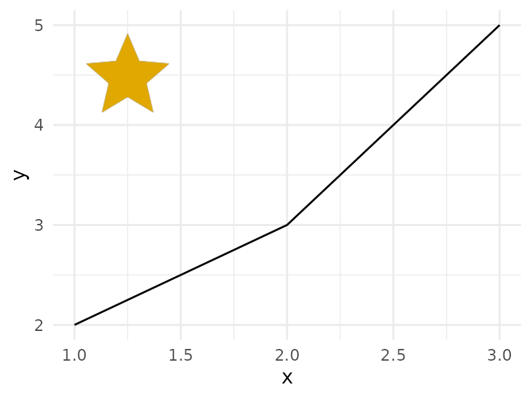

# Getting started

iconifyr wraps the [Iconify API](https://iconify.design/docs/api/).
Icons are identified as `prefix:name`, for example `mdi:home`.

## Fetch an icon

``` r

svg <- iconify_get("mdi:home", color = "#ba3329", size = 48)
cat(svg)
#> <svg xmlns="http://www.w3.org/2000/svg" width="48" height="48" viewBox="0 0 24 24"><path fill="#ba3329" d="M10 20v-6h4v6h5v-8h3L12 3L2 12h3v8z"/></svg>
```

`color`, `size` (height in pixels), `flip` and `rotate` map to the API’s
query parameters.

## Find icons

``` r

hits <- iconify_search("home", prefixes = c("mdi", "tabler"), limit = 40)
head(hits)
#>                     id prefix          name
#> 1             mdi:home    mdi          home
#> 2     mdi:home-outline    mdi  home-outline
#> 3          tabler:home tabler          home
#> 4   tabler:home-filled tabler   home-filled
#> 5        tabler:home-2 tabler        home-2
#> 6 tabler:home-2-filled tabler home-2-filled
```

``` r

sets <- iconify_sets()
head(sets[order(-sets$total), ], 5)
#>                    prefix                   name                author
#> 9                iconmind               IconMind              IconMind
#> 88                 fluent Fluent UI System Icons Microsoft Corporation
#> 10               iconoven               IconOven       Appic Marketing
#> 2  material-symbols-light Material Symbols Light                Google
#> 1        material-symbols       Material Symbols                Google
#>    license_spdx license_title total
#> 9           MIT           MIT 31722
#> 88          MIT           MIT 19900
#> 10          MIT           MIT 18236
#> 2    Apache-2.0    Apache 2.0 15793
#> 1    Apache-2.0    Apache 2.0 15728
length(iconify_icons("tabler"))
#> [1] 6238
```

## Inline icons in R Markdown and Quarto

[`iconify_html()`](https://noahweidig.github.io/iconifyr/reference/iconify_html.md)
returns raw HTML, so it works in inline code. For example,
`` `r iconifyr::iconify_html("mdi:github", size = 16)` `` renders as
.

In a chunk, use `results = "asis"`:

```` markdown
```{r, results = "asis"}
iconifyr::iconify_html("mdi:home", color = "steelblue", size = 32)
```
````

The same function works in Shiny UI code,
e.g. `tags$button(iconify_html("mdi:refresh"), "Reload")`.

## Icons in a gt table

``` r

ids <- c("mdi:home", "mdi:account", "mdi:cog")
tbl <- data.frame(
  id = ids,
  icon = vapply(ids, function(x) as.character(iconify_get(x, size = 20)), ""),
  stringsAsFactors = FALSE
)
gt::gt(tbl) |>
  gt::fmt_markdown(columns = "icon")
```

| id | icon |
|----|----|
| mdi:home |  |
| mdi:account |  |
| mdi:cog | ![](data:image/svg+xml;base64,PHN2ZyB4bWxucz0iaHR0cDovL3d3dy53My5vcmcvMjAwMC9zdmciIHdpZHRoPSIyMCIgaGVpZ2h0PSIyMCIgdmlld2JveD0iMCAwIDI0IDI0Ij48cGF0aCBmaWxsPSJjdXJyZW50Q29sb3IiIGQ9Ik0xMiAxNS41QTMuNSAzLjUgMCAwIDEgOC41IDEyQTMuNSAzLjUgMCAwIDEgMTIgOC41YTMuNSAzLjUgMCAwIDEgMy41IDMuNWEzLjUgMy41IDAgMCAxLTMuNSAzLjVtNy40My0yLjUzYy4wNC0uMzIuMDctLjY0LjA3LS45N3MtLjAzLS42Ni0uMDctMWwyLjExLTEuNjNjLjE5LS4xNS4yNC0uNDIuMTItLjY0bC0yLTMuNDZjLS4xMi0uMjItLjM5LS4zMS0uNjEtLjIybC0yLjQ5IDFjLS41Mi0uMzktMS4wNi0uNzMtMS42OS0uOThsLS4zNy0yLjY1QS41MDYuNTA2IDAgMCAwIDE0IDJoLTRjLS4yNSAwLS40Ni4xOC0uNS40MmwtLjM3IDIuNjVjLS42My4yNS0xLjE3LjU5LTEuNjkuOThsLTIuNDktMWMtLjIyLS4wOS0uNDkgMC0uNjEuMjJsLTIgMy40NmMtLjEzLjIyLS4wNy40OS4xMi42NEw0LjU3IDExYy0uMDQuMzQtLjA3LjY3LS4wNyAxcy4wMy42NS4wNy45N2wtMi4xMSAxLjY2Yy0uMTkuMTUtLjI1LjQyLS4xMi42NGwyIDMuNDZjLjEyLjIyLjM5LjMuNjEuMjJsMi40OS0xLjAxYy41Mi40IDEuMDYuNzQgMS42OS45OWwuMzcgMi42NWMuMDQuMjQuMjUuNDIuNS40Mmg0Yy4yNSAwIC40Ni0uMTguNS0uNDJsLjM3LTIuNjVjLjYzLS4yNiAxLjE3LS41OSAxLjY5LS45OWwyLjQ5IDEuMDFjLjIyLjA4LjQ5IDAgLjYxLS4yMmwyLTMuNDZjLjEyLS4yMi4wNy0uNDktLjEyLS42NHoiIC8+PC9zdmc+) |

## Icons in a ggplot

[`iconify_png()`](https://noahweidig.github.io/iconifyr/reference/iconify_png.md)
renders through rsvg. To place an icon on a plot, rasterize the SVG and
add it as an annotation.

``` r

svg <- iconify_get("mdi:star", color = "#e0a800", size = 128)
img <- rsvg::rsvg_nativeraster(charToRaw(svg), width = 128)
grob <- grid::rasterGrob(img, interpolate = TRUE)

ggplot2::ggplot(data.frame(x = 1:3, y = c(2, 3, 5)), ggplot2::aes(x, y)) +
  ggplot2::geom_line() +
  ggplot2::annotation_custom(grob, xmin = 1, xmax = 1.5, ymin = 4, ymax = 5) +
  ggplot2::theme_minimal()
```



## Save icons

``` r

paths <- iconify_download(c("mdi:home", "tabler:star"), dir = tempdir())
basename(paths)
#> [1] "mdi-home.svg"    "tabler-star.svg"
```

## Caching, retries and self-hosting

- Responses are cached under `tools::R_user_dir("iconifyr", "cache")`.
  Turn this off with `options(iconifyr.cache = FALSE)`; wipe it with
  [`iconify_cache_clear()`](https://noahweidig.github.io/iconifyr/reference/iconify_cache_clear.md).
- Requests retry up to 3 times on HTTP 429 and 5xx.
- Point the package at a self-hosted API with
  `options(iconifyr.api = "https://icons.example.org")`.
